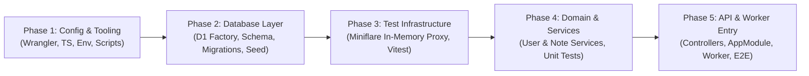

# Migration Plan: better-sqlite3 → Cloudflare D1 (with Miniflare)

---

## Executive Summary & Review Structure

This migration plan transitions the application from a local Node.js runtime (`better-sqlite3`, `@hono/node-server`, `dotenv`) to **Cloudflare Workers with Cloudflare D1** (SQLite at the edge), using **Miniflare** via Wrangler for local development and test isolation.

To simplify pull request (PR) reviews and prevent unmanageable "mega-PRs", the plan is structured into **5 distinct, reviewable phases** (recommended as stacked commits/PRs on a migration branch, with full end-to-end `typecheck` and `test` verification completing in Phase 5 once all consumers are wired):



| Phase | Title | Scope & Review Focus | Key Files |
| :--- | :--- | :--- | :--- |
| **Phase 1** | **Configuration, Tooling & Environment** | Infrastructure & dependencies: package scripts, Wrangler config, TypeScript types, and environment variable cleanups. | `package.json`, `wrangler.toml`, `drizzle.config.ts`, `tsconfig.json`, `.gitignore`, `.env*` |
| **Phase 2** | **Database Layer, Schema & D1 Migrations** | Core data layer: D1 factory, connection typing, idempotent SQL seed script, and obsolete file deletion. | `src/db/schema.ts`, `src/db/index.ts`, `src/types/env.type.ts`, `src/db/seed.sql` |
| **Phase 3** | **Testing Architecture with Miniflare** | Test harness: Vitest configuration, in-memory Miniflare D1 proxy helper with `{ persist: false }`, and automated migration runner. | `vitest.config.ts`, `src/test/test-db.ts` |
| **Phase 4** | **Domain Services & Unit Tests** | Business logic: Injecting `db: Db` into `UserService` and `NoteService`, `DrizzleQueryError` cause-aware unique constraint handling, empty update guards, and service unit tests. | `src/modules/*/*.service.ts`, `src/modules/*/*.service.test.ts` |
| **Phase 5** | **Composition Root, Controllers & Worker Entry** | HTTP & edge runtime: Scoped DB middleware in `app.module.ts`, 409 OpenAPI route responses, Hono route controllers, Worker export in `src/worker.ts`, HTTP integration tests, and docs. | `src/utils/route.util.ts`, `src/modules/app.module.ts`, `src/modules/*/*.controller.ts`, `src/worker.ts`, `src/index.ts` (delete), `src/modules/app.module.test.ts`, `README.md` |

---

## File Index

| File | Status | Phase | Description / Changes |
| :--- | :--- | :--- | :--- |
| `package.json` | Modified | Phase 1 | Remove `better-sqlite3`, `@types/better-sqlite3`, `@hono/node-server`, `dotenv`, `tsx`. Add `wrangler`. Update scripts. |
| `wrangler.toml` | New | Phase 1 | Worker configuration: compatibility flags, entry point, and D1 binding definition. |
| `drizzle.config.ts` | Modified | Phase 1 | Remove `dotenv/config` and file-based `dbCredentials`. Keep `dialect: 'sqlite'`. |
| `tsconfig.json` | Modified | Phase 1 | Keep `node` and add `vitest/globals` to `types`. Include `worker-configuration.d.ts` generated by `wrangler types`. |
| `.gitignore` | Modified | Phase 1 | Add `.wrangler/`, `.dev.vars`, and `*.sqlite`. |
| `.env` / `.env.example` | Deleted | Phase 1 | Remove obsolete Node SQLite `.env` and `.env.example` files. |
| `src/utils/hash.util.ts` | Retained | Phase 1 | Keep `.js` imports (`@noble/hashes/scrypt.js`) required by `@noble/hashes` exports. Note on Free Tier CPU limits. |
| `src/db/schema.ts` | Audited | Phase 2 | Confirm schema uses SQLite types (`text`, `integer`, `sqliteTable`) with `$defaultFn(() => crypto.randomUUID())`. |
| `src/db/index.ts` | Modified | Phase 2 | Replace `better-sqlite3` singleton with `createDb(d1: D1Database)` factory and export `Db` type. |
| `src/types/env.type.ts` | New | Phase 2 | Define `AppEnv` with `Bindings: Env` (from ambient `worker-configuration.d.ts`) and `Variables: { db: Db }`. |
| `src/db/seed.sql` | New | Phase 2 | Idempotent SQL seed script for D1 (`notes` and initial `users` with valid Scrypt hash). |
| `src/db/seed.ts` | Deleted | Phase 2 | Obsolete Node script importing `better-sqlite3`. Replaced by `wrangler d1 execute`. |
| `vitest.config.ts` | Modified | Phase 3 | Remove `globalSetup`, set `fileParallelism: false` and `testTimeout: 10000`. |
| `src/test/test-db.ts` | New | Phase 3 | Test helper using `getPlatformProxy({ persist: false })` with automated Drizzle migration execution. |
| `src/db/vitest-global-setup.ts` | Deleted | Phase 3 | Obsolete Vitest setup script using `npx drizzle-kit push` on local file. |
| `src/modules/user/user.service.ts` | Modified | Phase 4 | Accept `db: Db` as first argument in all static methods. Align unique constraint handling (including `err.cause`) and single-query empty update guard. |
| `src/modules/user/user.service.test.ts` | Modified | Phase 4 | Refactor for `setupTestDb` and `db` parameter. Preserve all 10 unit test cases with explicit HTTP status assertions (`409` / `404`). |
| `src/modules/note/note.service.ts` | Modified | Phase 4 | Accept `db: Db` as first argument in all static methods. Guard against empty update payloads. |
| `src/modules/note/note.service.test.ts` | Modified | Phase 4 | Refactor for `setupTestDb` and `db` parameter with explicit HTTP status assertions. Clean up state in `afterAll`. |
| `src/utils/route.util.ts` | Modified | Phase 5 | Add `409 Conflict` response schema to `CreateRouteUtil` OpenAPI specification. |
| `src/modules/app.module.ts` | Modified | Phase 5 | Type app with `OpenAPIHono<AppEnv>`, scope DB middleware to `/user/*` and `/note/*` (after docs/health routes), and align `err.cause` constraint error handling. |
| `src/modules/common/common.controller.ts` | Modified | Phase 5 | Type router with `OpenAPIHono<AppEnv>` for consistent route mounting. |
| `src/modules/user/user.controller.ts` | Modified | Phase 5 | Type router with `OpenAPIHono<AppEnv>`, forward `c.var.db` to `UserService`. |
| `src/modules/note/note.controller.ts` | Modified | Phase 5 | Type router with `OpenAPIHono<AppEnv>`, forward `c.var.db` to `NoteService`. |
| `src/worker.ts` | New | Phase 5 | Cloudflare Worker entry point exporting `default app`. |
| `src/index.ts` | Deleted | Phase 5 | Obsolete Node.js entry point (`serve()` from `@hono/node-server`). |
| `src/modules/app.module.test.ts` | New | Phase 5 | HTTP integration tests via `app.request()` verifying middleware, routing, 201 creation, 409 conflicts, and 400 validation errors. |
| `README.md` | Modified | Phase 5 | Update setup, migration, seeding, and local development instructions for Cloudflare D1 and Wrangler. |

---

## Phase 1 — Configuration, Tooling & Environment Setup

### Objective
Establish Cloudflare Worker infrastructure, install Wrangler, configure TypeScript ambient types for Workers, and clean up Node-specific environment configurations.

### Tasks

#### 1.1 Update Dependencies & Package Scripts
**File:** `package.json`

- Remove Node-specific packages: `better-sqlite3`, `@types/better-sqlite3`, `@hono/node-server`, `dotenv`, and `tsx`.
- Add `wrangler` to `devDependencies`.
- Update npm scripts for Worker development, D1 migrations, seeding, and type generation.

```bash
pnpm remove better-sqlite3 @types/better-sqlite3 @hono/node-server dotenv tsx
pnpm add -D wrangler
```

```json
// package.json (Updated scripts)
{
  "name": "honest",
  "type": "module",
  "scripts": {
    "dev": "wrangler dev",
    "deploy": "wrangler deploy",
    "test": "vitest run",
    "test:watch": "vitest",
    "typecheck": "tsc --noEmit",
    "types:generate": "wrangler types",
    "db:generate": "drizzle-kit generate",
    "db:migrate:local": "wrangler d1 migrations apply honest-db --local --yes",
    "db:migrate:remote": "wrangler d1 migrations apply honest-db --remote --yes",
    "db:seed": "wrangler d1 execute honest-db --local --file=./src/db/seed.sql",
    "ncu": "ncu"
  }
}
```

#### 1.2 Worker Configuration (`wrangler.toml`)
**File:** `wrangler.toml` (New file)

Defines the Worker runtime settings, compatibility date, Node.js compatibility flags, and D1 database binding named `DB`.

> [!WARNING]
> `database_id = "honest-db-local"` is a local development placeholder. While Wrangler accepts this for local emulation (`--local`), remote deployment (`wrangler deploy` or `wrangler d1 migrations apply --remote`) requires a real Cloudflare D1 UUID.
> Before deploying to production, run:
> ```bash
> wrangler d1 create honest-db
> ```
> and update `database_id` with the returned UUID.

```toml
# wrangler.toml
name = "honest"
compatibility_date = "2025-07-25"
compatibility_flags = ["nodejs_compat"]
main = "src/worker.ts"

[[d1_databases]]
binding = "DB"
database_name = "honest-db"
database_id = "honest-db-local"
migrations_dir = "drizzle"
```

#### 1.3 Drizzle Kit Configuration
**File:** `drizzle.config.ts`

Drizzle Kit only requires `schema`, `out`, and `dialect: 'sqlite'`. Remove `dotenv/config` and file-based `dbCredentials`. Migrations are applied via Wrangler CLI.

```ts
// drizzle.config.ts
import { defineConfig } from "drizzle-kit";

export default defineConfig({
  out: "./drizzle",
  schema: "./src/db/schema.ts",
  dialect: "sqlite",
});
```

#### 1.4 TypeScript Configuration & Type Generation
**File:** `tsconfig.json`

Modern `wrangler types` generates both the `Env` interface and the Worker runtime ambient types (`D1Database`, etc.) in `worker-configuration.d.ts`. Do **not** add `@cloudflare/workers-types` alongside `worker-configuration.d.ts`, as having both causes duplicate type declarations. Keep `"node"` (for `nodejs_compat` and `wrangler` test helpers) and `"vitest/globals"` in `compilerOptions.types`, and include `worker-configuration.d.ts`.

```json
// tsconfig.json
{
  "compilerOptions": {
    "target": "ESNext",
    "module": "NodeNext",
    "strict": true,
    "verbatimModuleSyntax": true,
    "skipLibCheck": true,
    "types": ["node", "vitest/globals"],
    "jsx": "react-jsx",
    "jsxImportSource": "hono/jsx",
    "noEmit": true,
    "allowImportingTsExtensions": true
  },
  "include": ["src/**/*", "worker-configuration.d.ts"]
}
```

Generate ambient Worker environment types:
```bash
pnpm run types:generate
```

#### 1.5 Environment & Git Ignore Cleanup
**Files:** `.gitignore`, `.env` (Delete), `.env.example` (Delete)

- Add `.wrangler/`, `.dev.vars`, and `*.sqlite` to `.gitignore`.
- Delete `.env` and `.env.example` (which only held `DATABASE_URL` and `DATABASE_URL_TEST`).
- Delete any untracked local SQLite files (`sqlite.db*`).

```
# .gitignore additions
.wrangler/
.dev.vars
*.sqlite
```

#### 1.6 Hash Utility Verification (Audit Only)
**File:** `src/utils/hash.util.ts`

- **CRITICAL NOTE ON HASH UTILITY:** In `src/utils/hash.util.ts`, do **NOT** remove the `.js` extension from imports (`import ... from '@noble/hashes/scrypt.js'`). The `@noble/hashes` package defines subpath exports exclusively with `.js`.
- **WORKERS CPU LIMIT NOTE:** `@noble/hashes/scryptAsync` is pure JavaScript. Computing Scrypt with $N=16384$ takes ~100ms CPU time. Cloudflare Workers Free Tier enforces a **10ms–50ms CPU execution limit**. If deploying to the free tier, consider migrating to Web Crypto API (`crypto.subtle.deriveBits` with PBKDF2) or tuning Scrypt cost parameters.

### Phase 1 Review Checklist
- [ ] `package.json` contains no references to `better-sqlite3`, `@hono/node-server`, `dotenv`, or `tsx`.
- [ ] `wrangler.toml` defines `main = "src/worker.ts"` and `binding = "DB"`.
- [ ] `worker-configuration.d.ts` is generated successfully via `pnpm run types:generate`.
- [ ] `.env` and `.env.example` are deleted, and local SQLite/Wrangler artifacts are ignored in `.gitignore`.

---

## Phase 2 — Database Layer, Schema & D1 Migrations

### Objective
Transform the database access pattern from a global Node.js singleton (`better-sqlite3`) to a Cloudflare D1 client factory (`drizzle-orm/d1`), establish typed environment definitions, create idempotent seed SQL data, and remove obsolete Node seed files.

### Tasks

#### 2.1 Schema Verification
**File:** `src/db/schema.ts`

Verify SQLite schema definitions and primary key generators. Global `crypto.randomUUID()` is natively supported in Cloudflare Workers.

```ts
// src/db/schema.ts
import { sqliteTable, text, integer } from "drizzle-orm/sqlite-core";

export const notes = sqliteTable("notes", {
  id: text("id")
    .primaryKey()
    .$defaultFn(() => crypto.randomUUID()),
  date: text("date").notNull(),
  vendor: text("vendor").notNull(),
  name: text("name").notNull(),
  amount: integer("amount").notNull(),
  unit: text("unit").notNull(),
  price: integer("price").notNull(),
  category: text("category").notNull(),
  totalPrice: integer("total_price").notNull(),
  status: text("status").notNull().default("pending"),
});

export const userTable = sqliteTable("users", {
  id: text("id")
    .primaryKey()
    .$defaultFn(() => crypto.randomUUID()),
  username: text("username", { length: 100 }).notNull(),
  email: text("email", { length: 255 }).notNull().unique(),
  password: text("password", { length: 255 }).notNull(),
});
```

#### 2.2 D1 Database Factory
**File:** `src/db/index.ts`

In Cloudflare Workers, database connections cannot be global singletons using file-system paths. The D1 binding is injected per-request on `c.env.DB`. Provide a lightweight factory function `createDb(d1: D1Database)` (using ambient `D1Database` from `worker-configuration.d.ts`) that initializes the Drizzle D1 adapter, and export the derived `Db` type.

```ts
// src/db/index.ts
import { drizzle } from "drizzle-orm/d1";
import * as schema from "./schema.ts";

export function createDb(d1: D1Database) {
  return drizzle(d1, { schema });
}

export type Db = ReturnType<typeof createDb>;
```

#### 2.3 Application Environment Types
**File:** `src/types/env.type.ts` (New file)

Bind `Bindings: Env` (where `Env` is generated by `wrangler types` in `worker-configuration.d.ts`) and declare `Variables: { db: Db }` for Hono context.

```ts
// src/types/env.type.ts
import type { Db } from "../db/index.ts";

export type AppEnv = {
  Bindings: Env;
  Variables: {
    db: Db;
  };
};
```

#### 2.4 D1 Seed SQL Script & Legacy Cleanup
**Files:** `src/db/seed.sql` (New file), `src/db/seed.ts` (Delete)

- Create `src/db/seed.sql` with idempotent (`INSERT OR IGNORE INTO`) seed data for both `notes` and `users` (using a real `@noble/hashes/scrypt.js` hash of `'secret123'` with `N=16384, r=8, p=1, dkLen=32`).
- Delete `src/db/seed.ts` which uses Node file-system execution and `better-sqlite3`.

```sql
-- src/db/seed.sql
INSERT OR IGNORE INTO notes (id, date, vendor, name, amount, unit, price, category, total_price, status)
VALUES (
  '550e8400-e29b-41d4-a716-446655440001',
  '2024-01-01',
  'Office Supplies Co.',
  'Printer Paper A4',
  5,
  'ream',
  50000,
  'Stationery',
  250000,
  'pending'
);

-- Seed user: password is 'secret123' hashed with @noble/hashes/scrypt.js (N=16384, r=8, p=1, dkLen=32)
INSERT OR IGNORE INTO users (id, username, email, password)
VALUES (
  '550e8400-e29b-41d4-a716-446655440002',
  'admin',
  'admin@example.com',
  'a1b2c3d4e5f60718293a4b5c6d7e8f90:f50f18bde60075b77ba3745d42637b9f64453b20a0376501ff9cabb2077bf3ef'
);
```

### Phase 2 Review Checklist
- [ ] `src/db/index.ts` exports `createDb(d1: D1Database)` and `type Db`. No `better-sqlite3` imports remain.
- [ ] `src/types/env.type.ts` references ambient `Env` and typed `Db`.
- [ ] `src/db/seed.sql` uses idempotent `INSERT OR IGNORE INTO` statements and a valid Scrypt password hash.
- [ ] `src/db/seed.ts` is deleted.
- [ ] Migrations generate cleanly: `pnpm run db:generate`.
- [ ] Local migrations and seeds execute without error (including repeated runs):
  ```bash
  pnpm run db:migrate:local
  pnpm run db:seed
  ```

---

## Phase 3 — Testing Architecture with Miniflare

### Objective
Establish the automated test harness for Cloudflare D1 using Wrangler's `getPlatformProxy()` with Miniflare, ensuring complete test isolation and automated in-memory migration execution.

### Tasks

#### 3.1 Vitest Configuration
**File:** `vitest.config.ts`

- Remove obsolete `globalSetup: ["./src/db/vitest-global-setup.ts"]` and file-based `env` variables.
- Set `fileParallelism: false` to prevent SQLite/Miniflare lock collisions during test runs.
- Increase test timeout to `10000` ms.

```ts
// vitest.config.ts
import { defineConfig } from "vitest/config";

export default defineConfig({
  test: {
    globals: true,
    fileParallelism: false,
    testTimeout: 10000,
  },
});
```

#### 3.2 Miniflare In-Memory Test Helper
**File:** `src/test/test-db.ts` (New file)

- **CRITICAL ISOLATION REQUIREMENT:** `getPlatformProxy({ persist: false })` MUST be used. Without `{ persist: false }`, tests write to `.wrangler/state/v3/d1`, wiping or corrupting the developer's local dev database.
- Uses `drizzle-orm/d1/migrator` to apply migrations automatically from `./drizzle` to the in-memory D1 proxy.
- Provides `teardownTestDb()` to cleanly dispose the proxy instance.

```ts
// src/test/test-db.ts
import { getPlatformProxy } from "wrangler";
import { migrate } from "drizzle-orm/d1/migrator";
import { createDb, type Db } from "../db/index.ts";

let proxy: Awaited<ReturnType<typeof getPlatformProxy<Env>>> | null = null;
let testDb: Db | null = null;

/**
 * Initializes an isolated, in-memory D1 database proxy for testing and applies all migrations.
 * Using persist: false ensures test data NEVER writes to or corrupts the local dev database.
 */
export async function setupTestDb(): Promise<{ db: Db; d1: D1Database }> {
  if (!proxy) {
    proxy = await getPlatformProxy<Env>({ persist: false });
    testDb = createDb(proxy.env.DB);
    await migrate(testDb, { migrationsFolder: "./drizzle" });
  }

  return { db: testDb!, d1: proxy.env.DB };
}

export async function teardownTestDb(): Promise<void> {
  if (proxy) {
    await proxy.dispose();
    proxy = null;
    testDb = null;
  }
}
```

#### 3.3 Obsolete Test Setup Removal
**File:** `src/db/vitest-global-setup.ts` (Delete)

Delete obsolete file that executed `drizzle-kit push` on `./sqlite.test.db`.

### Phase 3 Review Checklist
- [ ] `vitest.config.ts` has `fileParallelism: false` and no references to `vitest-global-setup.ts`.
- [ ] `src/test/test-db.ts` strictly enforces `{ persist: false }` in `getPlatformProxy()`.
- [ ] `src/db/vitest-global-setup.ts` is deleted.

---

## Phase 4 — Domain Services & Unit Tests

### Objective
Refactor domain services to accept request-scoped `db: Db` via method parameter injection, handle SQLite/D1 constraint violations (including `DrizzleQueryError` where the underlying D1 error is in `err.cause`), guard against empty updates without redundant queries, and update unit test suites to run against Miniflare with explicit HTTP status code assertions.

### Tasks

#### 4.1 User Service Refactoring
**File:** `src/modules/user/user.service.ts`

- Remove global `db` import; accept `db: Db` as the first argument in all static methods.
- Standardize duplicate email error status to `409 Conflict`.
- Inspect both `err.message` and `err.cause` for `"UNIQUE constraint failed"` because `drizzle-orm` wraps D1 driver errors in `DrizzleQueryError` with the driver message on `err.cause`.
- Select `username` in `updateUser`'s initial existence check so the empty update guard can return `existing[0]` directly without a second DB query.

```ts
// src/modules/user/user.service.ts
import { HTTPException } from "hono/http-exception";
import { eq } from "drizzle-orm";
import type { Db } from "../../db/index.ts";
import { userTable } from "../../db/schema.ts";
import { hashPassword } from "../../utils/hash.util.ts";
import type { UserCreate, UserUpdate } from "./user.entity.ts";

function isUniqueConstraintError(err: unknown): boolean {
  if (!(err instanceof Error)) return false;
  const msg =
    err.message + (err.cause instanceof Error ? ` ${err.cause.message}` : "");
  return msg.includes("UNIQUE constraint failed");
}

class UserService {
  static async getAllUsers(db: Db) {
    return db
      .select({
        id: userTable.id,
        username: userTable.username,
        email: userTable.email,
      })
      .from(userTable);
  }

  static async getUserById(db: Db, id: string) {
    const result = await db
      .select({
        id: userTable.id,
        username: userTable.username,
        email: userTable.email,
      })
      .from(userTable)
      .where(eq(userTable.id, id))
      .limit(1);

    if (result.length === 0) {
      throw new HTTPException(404, {
        message: `User with id ${id} is not found`,
      });
    }

    return result[0];
  }

  static async createUser(db: Db, user: UserCreate) {
    const existing = await db
      .select({ id: userTable.id })
      .from(userTable)
      .where(eq(userTable.email, user.email))
      .limit(1);
    if (existing.length > 0) {
      throw new HTTPException(409, {
        message: `User with email ${user.email} already exists`,
      });
    }

    const hashedPassword = await hashPassword(user.password);

    try {
      const result = await db
        .insert(userTable)
        .values({
          username: user.username,
          email: user.email,
          password: hashedPassword,
        })
        .returning({
          id: userTable.id,
          username: userTable.username,
          email: userTable.email,
        });

      return result[0];
    } catch (err: unknown) {
      if (isUniqueConstraintError(err)) {
        throw new HTTPException(409, {
          message: `User with email ${user.email} already exists`,
        });
      }
      throw err;
    }
  }

  static async updateUser(db: Db, id: string, updatedUser: UserUpdate) {
    const existing = await db
      .select({
        id: userTable.id,
        username: userTable.username,
        email: userTable.email,
      })
      .from(userTable)
      .where(eq(userTable.id, id))
      .limit(1);
    if (existing.length === 0) {
      throw new HTTPException(404, {
        message: `User with id ${id} is not found`,
      });
    }

    if (updatedUser.email && updatedUser.email !== existing[0].email) {
      const duplicate = await db
        .select({ id: userTable.id })
        .from(userTable)
        .where(eq(userTable.email, updatedUser.email))
        .limit(1);
      if (duplicate.length > 0) {
        throw new HTTPException(409, {
          message: `User with email ${updatedUser.email} already exists`,
        });
      }
    }

    const values: Partial<typeof userTable.$inferInsert> = {};
    if (updatedUser.username !== undefined)
      values.username = updatedUser.username;
    if (updatedUser.email !== undefined) values.email = updatedUser.email;
    if (updatedUser.password !== undefined)
      values.password = await hashPassword(updatedUser.password);

    // Guard empty update payload to prevent SQLite syntax error without a second query
    if (Object.keys(values).length === 0) {
      return existing[0];
    }

    try {
      const result = await db
        .update(userTable)
        .set(values)
        .where(eq(userTable.id, id))
        .returning({
          id: userTable.id,
          username: userTable.username,
          email: userTable.email,
        });

      return result[0];
    } catch (err: unknown) {
      if (isUniqueConstraintError(err)) {
        throw new HTTPException(409, {
          message: `User with email ${updatedUser.email} already exists`,
        });
      }
      throw err;
    }
  }

  static async deleteUser(db: Db, id: string) {
    const result = await db
      .delete(userTable)
      .where(eq(userTable.id, id))
      .returning({
        id: userTable.id,
        username: userTable.username,
        email: userTable.email,
      });

    if (result.length === 0) {
      throw new HTTPException(404, {
        message: `User with id ${id} is not found`,
      });
    }

    return result[0];
  }
}

export { UserService };
```

#### 4.2 User Service Unit Tests
**File:** `src/modules/user/user.service.test.ts`

- Use `setupTestDb()` in `beforeAll` and `teardownTestDb()` in `afterAll`.
- Preserve all 10 unit test cases and assert both `HTTPException` instance and exact HTTP status codes (`409` / `404`).

```ts
// src/modules/user/user.service.test.ts
import { eq } from "drizzle-orm";
import { HTTPException } from "hono/http-exception";
import { describe, it, expect, beforeAll, afterAll } from "vitest";

import { UserService } from "./user.service.ts";
import { userTable } from "../../db/schema.ts";
import { setupTestDb, teardownTestDb } from "../../test/test-db.ts";
import type { Db } from "../../db/index.ts";

describe("UserService", () => {
  let db: Db;
  let createdId: string;

  beforeAll(async () => {
    const setup = await setupTestDb();
    db = setup.db;
  });

  afterAll(async () => {
    if (db) {
      await db.delete(userTable);
    }
    await teardownTestDb();
  });

  it("should create a user", async () => {
    const user = await UserService.createUser(db, {
      username: "johndoe",
      email: "john@example.com",
      password: "secret123",
    });

    expect(user).toHaveProperty("id");
    expect(user.username).toBe("johndoe");
    expect(user.email).toBe("john@example.com");
    expect(user).not.toHaveProperty("password");

    createdId = user.id;
  });

  it("should throw 409 when creating user with duplicate email", async () => {
    const promise = UserService.createUser(db, {
      username: "janedoe",
      email: "john@example.com",
      password: "secret456",
    });
    await expect(promise).rejects.toBeInstanceOf(HTTPException);
    await expect(promise).rejects.toMatchObject({ status: 409 });
  });

  it("should get all users", async () => {
    const allUsers = await UserService.getAllUsers(db);
    expect(allUsers.length).toBeGreaterThan(0);
    expect(allUsers[0]).toHaveProperty("id");
    expect(allUsers[0]).not.toHaveProperty("password");
  });

  it("should get user by id", async () => {
    const user = await UserService.getUserById(db, createdId);
    expect(user.id).toBe(createdId);
    expect(user.username).toBe("johndoe");
    expect(user).not.toHaveProperty("password");
  });

  it("should throw 404 when user not found", async () => {
    const promise = UserService.getUserById(
      db,
      "550e8400-e29b-41d4-a716-446655440000",
    );
    await expect(promise).rejects.toBeInstanceOf(HTTPException);
    await expect(promise).rejects.toMatchObject({ status: 404 });
  });

  it("should update a user", async () => {
    const updated = await UserService.updateUser(db, createdId, {
      username: "johndoe_updated",
    });

    expect(updated.username).toBe("johndoe_updated");
    expect(updated.email).toBe("john@example.com");
  });

  it("should throw 404 when updating non-existent user", async () => {
    const promise = UserService.updateUser(
      db,
      "550e8400-e29b-41d4-a716-446655440000",
      {
        username: "ghost",
      },
    );
    await expect(promise).rejects.toBeInstanceOf(HTTPException);
    await expect(promise).rejects.toMatchObject({ status: 404 });
  });

  it("should throw 409 when updating user with duplicate email", async () => {
    await UserService.createUser(db, {
      username: "janedoe",
      email: "jane@example.com",
      password: "secret789",
    });

    const promise = UserService.updateUser(db, createdId, {
      email: "jane@example.com",
    });
    await expect(promise).rejects.toBeInstanceOf(HTTPException);
    await expect(promise).rejects.toMatchObject({ status: 409 });
  });

  it("should delete a user", async () => {
    const { id: secondUserId } = await UserService.createUser(db, {
      username: "deleteme",
      email: "delete@example.com",
      password: "secret000",
    });

    const deleted = await UserService.deleteUser(db, secondUserId);
    expect(deleted.id).toBe(secondUserId);

    const remaining = await db
      .select()
      .from(userTable)
      .where(eq(userTable.id, secondUserId));
    expect(remaining.length).toBe(0);
  });

  it("should throw 404 when deleting non-existent user", async () => {
    const promise = UserService.deleteUser(
      db,
      "550e8400-e29b-41d4-a716-446655440000",
    );
    await expect(promise).rejects.toBeInstanceOf(HTTPException);
    await expect(promise).rejects.toMatchObject({ status: 404 });
  });
});
```

#### 4.3 Note Service Refactoring
**File:** `src/modules/note/note.service.ts`

- Remove global `db` import; accept `db: Db` as the first argument in all static methods.
- Guard against empty update payloads.

```ts
// src/modules/note/note.service.ts
import { HTTPException } from "hono/http-exception";
import { eq } from "drizzle-orm";
import type { Db } from "../../db/index.ts";
import { notes } from "../../db/schema.ts";
import type { NoteCreate, NoteUpdate } from "./note.entity.ts";

class NoteService {
  static async getAllNotes(db: Db) {
    return await db.select().from(notes);
  }

  static async getNoteById(db: Db, id: string) {
    const result = await db
      .select()
      .from(notes)
      .where(eq(notes.id, id))
      .limit(1);

    if (result.length === 0) {
      throw new HTTPException(404, {
        message: `Note with id ${id} is not found`,
      });
    }

    return result[0];
  }

  static async createNote(db: Db, note: NoteCreate) {
    const result = await db
      .insert(notes)
      .values({
        ...note,
        status: "pending",
      })
      .returning();

    return result[0];
  }

  static async updateNote(db: Db, id: string, updatedNote: NoteUpdate) {
    // Guard empty update payload to prevent SQLite syntax error
    if (Object.keys(updatedNote).length === 0) {
      return await this.getNoteById(db, id);
    }

    const result = await db
      .update(notes)
      .set(updatedNote)
      .where(eq(notes.id, id))
      .returning();

    if (result.length === 0) {
      throw new HTTPException(404, {
        message: `Note with id ${id} is not found`,
      });
    }

    return result[0];
  }

  static async deleteNote(db: Db, id: string) {
    const result = await db.delete(notes).where(eq(notes.id, id)).returning();

    if (result.length === 0) {
      throw new HTTPException(404, {
        message: `Note with id ${id} is not found`,
      });
    }

    return result[0];
  }
}

export { NoteService };
```

#### 4.4 Note Service Unit Tests
**File:** `src/modules/note/note.service.test.ts`

```ts
// src/modules/note/note.service.test.ts
import { eq } from "drizzle-orm";
import { HTTPException } from "hono/http-exception";
import { describe, it, expect, beforeAll, afterAll } from "vitest";

import { NoteService } from "./note.service.ts";
import { notes } from "../../db/schema.ts";
import { setupTestDb, teardownTestDb } from "../../test/test-db.ts";
import type { Db } from "../../db/index.ts";

describe("NoteService", () => {
  let db: Db;
  let createdId: string;

  beforeAll(async () => {
    const setup = await setupTestDb();
    db = setup.db;
  });

  afterAll(async () => {
    if (db) {
      await db.delete(notes);
    }
    await teardownTestDb();
  });

  it("should create a note with pending status", async () => {
    const note = await NoteService.createNote(db, {
      date: "2024-01-01",
      vendor: "Test Vendor",
      name: "Test Note",
      amount: 10,
      unit: "pcs",
      price: 1000,
      category: "Test",
      totalPrice: 10000,
      status: "pending",
    });

    expect(note).toHaveProperty("id");
    expect(note.vendor).toBe("Test Vendor");
    expect(note.status).toBe("pending");
    expect(typeof note.amount).toBe("number");
    expect(typeof note.price).toBe("number");
    expect(typeof note.totalPrice).toBe("number");

    createdId = note.id;
  });

  it("should get all notes", async () => {
    const allNotes = await NoteService.getAllNotes(db);
    expect(allNotes.length).toBeGreaterThan(0);
    expect(allNotes[0]).toHaveProperty("id");
    expect(typeof allNotes[0].status).toBe("string");
  });

  it("should get note by id", async () => {
    const note = await NoteService.getNoteById(db, createdId);
    expect(note.id).toBe(createdId);
    expect(note.vendor).toBe("Test Vendor");
    expect(typeof note.status).toBe("string");
  });

  it("should throw 404 when note not found", async () => {
    const promise = NoteService.getNoteById(
      db,
      "550e8400-e29b-41d4-a716-446655440000",
    );
    await expect(promise).rejects.toBeInstanceOf(HTTPException);
    await expect(promise).rejects.toMatchObject({ status: 404 });
  });

  it("should update a note", async () => {
    const updated = await NoteService.updateNote(db, createdId, {
      vendor: "Updated Vendor",
    });

    expect(updated.vendor).toBe("Updated Vendor");
    expect(typeof updated.status).toBe("string");
  });

  it("should delete a note", async () => {
    const deleted = await NoteService.deleteNote(db, createdId);
    expect(deleted.id).toBe(createdId);

    const remaining = await db
      .select()
      .from(notes)
      .where(eq(notes.id, createdId));
    expect(remaining.length).toBe(0);
  });
});
```

### Phase 4 Review Checklist
- [ ] `UserService` and `NoteService` do not import a global `db` instance.
- [ ] Both services include guard logic against empty update payloads.
- [ ] Duplicate email errors throw HTTP 409 consistently (inspecting both `err.message` and `err.cause`).
- [ ] All unit tests assert explicit HTTP status codes and pass cleanly against the Miniflare test harness:
  ```bash
  pnpm test src/modules/user/user.service.test.ts src/modules/note/note.service.test.ts
  ```

---

## Phase 5 — Composition Root, Controllers, Worker Entry & E2E Integration

### Objective
Document `409 Conflict` in `CreateRouteUtil`, wire the request-scoped database context into Hono controllers, attach the database initialization middleware to `app.module.ts`, export the native Worker entry point, remove `@hono/node-server`, verify the complete request lifecycle with HTTP integration tests, and update `README.md`.

### Tasks

#### 5.0 OpenAPI Route Utility (`409 Conflict` Response)
**File:** `src/utils/route.util.ts`

Add `409` (`Conflict`) to the standard `responses` map in `CreateRouteUtil.createRouteUtil` so `/doc` reflects the `409` status returned on duplicate resources.

```ts
// src/utils/route.util.ts (inside responses block of createRouteUtil)
        404: {
          content: {
            "application/json": {
              schema: ErrorResponseSchema,
            },
          },
          description: "Not Found",
        },
        409: {
          content: {
            "application/json": {
              schema: ErrorResponseSchema,
            },
          },
          description: "Conflict",
        },
        500: {
```

#### 5.1 Composition Root & DB Middleware
**File:** `src/modules/app.module.ts`

- Type `app` with `OpenAPIHono<AppEnv>`.
- Register OpenAPI documentation (`/doc`, `/doc-ui`) and health check (`/`) routes before the DB middleware so they do not require a D1 binding to respond.
- Add scoped DB middleware for `/user/*` and `/note/*` (or after docs/common routes) that validates `c.env.DB` and runs `c.set('db', createDb(c.env.DB))`.
- Catch SQLite/D1 `UNIQUE constraint failed` errors (including `err.cause` from `DrizzleQueryError`) in `onError` and return `409 Conflict`.

```ts
// src/modules/app.module.ts
import { HTTPException } from "hono/http-exception";
import { OpenAPIHono } from "@hono/zod-openapi";
import { swaggerUI } from "@hono/swagger-ui";
import { createDb } from "../db/index.ts";
import type { AppEnv } from "../types/env.type.ts";

import common from "./common/common.controller.ts";
import note from "./note/note.controller.ts";
import user from "./user/user.controller.ts";

const app = new OpenAPIHono<AppEnv>({
  defaultHook: (result, c) => {
    if (!result.success) {
      return c.json(
        {
          message: result.error.issues
            .map((i) => `${i.path.join(".")}: ${i.message}`)
            .join(", "),
        },
        400,
      );
    }
  },
});

app.doc("/doc", {
  openapi: "3.0.0",
  info: {
    version: "1.0.0",
    title: "Honest API",
  },
});
app.get("/doc-ui", swaggerUI({ url: "/doc" }));
app.route("/", common);

// Middleware: initialize scoped DB binding for database-backed routes
app.use("/user/*", async (c, next) => {
  if (!c.env?.DB) {
    throw new Error(
      'D1 database binding "DB" is not configured in request environment',
    );
  }
  c.set("db", createDb(c.env.DB));
  await next();
});

app.use("/note/*", async (c, next) => {
  if (!c.env?.DB) {
    throw new Error(
      'D1 database binding "DB" is not configured in request environment',
    );
  }
  c.set("db", createDb(c.env.DB));
  await next();
});

app.route("/user", user);
app.route("/note", note);

app.onError((err, c) => {
  console.error(
    JSON.stringify({
      error: err instanceof Error ? err.message : String(err),
      stack: err instanceof Error ? err.stack : undefined,
      method: c.req.method,
      url: c.req.url,
    }),
  );

  if (err instanceof HTTPException) {
    return c.json({ message: err.message }, err.status);
  }

  // D1 / SQLite unique constraint violation (direct or via DrizzleQueryError.cause)
  if (err instanceof Error) {
    const fullMessage =
      err.message + (err.cause instanceof Error ? ` ${err.cause.message}` : "");
    if (fullMessage.includes("UNIQUE constraint failed")) {
      return c.json({ message: "Resource already exists" }, 409);
    }
  }

  return c.json({ message: "Internal Server Error" }, 500);
});

export default app;
```

#### 5.2 Common Controller Typing
**File:** `src/modules/common/common.controller.ts`

```ts
// src/modules/common/common.controller.ts
import { OpenAPIHono } from "@hono/zod-openapi";
import type { AppEnv } from "../../types/env.type.ts";
import { CreateRouteUtil } from "../../utils/route.util.ts";

const app = new OpenAPIHono<AppEnv>();
const commonRoute = new CreateRouteUtil(["Common"]);

app.openapi(
  commonRoute.createRouteUtil({
    method: "get",
    path: "/",
  }),
  (c) => {
    return c.json({ message: "Hono API is starting" });
  },
);

export default app;
```

#### 5.3 User Controller Context Forwarding
**File:** `src/modules/user/user.controller.ts`

Type router with `OpenAPIHono<AppEnv>` and pass `c.var.db` to `UserService`.

```ts
// src/modules/user/user.controller.ts
import { OpenAPIHono } from "@hono/zod-openapi";
import type { AppEnv } from "../../types/env.type.ts";
import { UserService } from "./user.service.ts";
import {
  UserSchema,
  UsersSchema,
  UserCreateSchema,
  UserUpdateSchema,
  type User,
} from "./user.entity.ts";
import { CreateRouteUtil, IdParamSchema } from "../../utils/route.util.ts";

const app = new OpenAPIHono<AppEnv>();
const userRoute = new CreateRouteUtil(["User"]);

app.openapi(
  userRoute.createRouteUtil({
    method: "get",
    path: "/",
    responseSchema: UsersSchema,
  }),
  async (c) => {
    const users = await UserService.getAllUsers(c.var.db);
    return c.json(users);
  },
);

app.openapi(
  userRoute.createRouteUtil({
    method: "post",
    path: "/",
    requestSchema: UserCreateSchema,
    responseSchema: UserSchema,
    status: 201,
  }),
  async (c) => {
    const body = c.req.valid("json");
    const user: User = await UserService.createUser(c.var.db, body);
    return c.json(user, 201);
  },
);

app.openapi(
  userRoute.createRouteUtil({
    method: "get",
    path: "/{id}",
    paramsSchema: IdParamSchema,
    responseSchema: UserSchema,
  }),
  async (c) => {
    const { id } = c.req.valid("param");
    const user: User = await UserService.getUserById(c.var.db, id);
    return c.json(user);
  },
);

app.openapi(
  userRoute.createRouteUtil({
    method: "put",
    path: "/{id}",
    paramsSchema: IdParamSchema,
    requestSchema: UserUpdateSchema,
    responseSchema: UserSchema,
  }),
  async (c) => {
    const { id } = c.req.valid("param");
    const body = c.req.valid("json");
    const user: User = await UserService.updateUser(c.var.db, id, body);
    return c.json(user);
  },
);

app.openapi(
  userRoute.createRouteUtil({
    method: "delete",
    path: "/{id}",
    paramsSchema: IdParamSchema,
    responseSchema: UserSchema,
  }),
  async (c) => {
    const { id } = c.req.valid("param");
    const user: User = await UserService.deleteUser(c.var.db, id);
    return c.json(user);
  },
);

export default app;
```

#### 5.4 Note Controller Context Forwarding
**File:** `src/modules/note/note.controller.ts`

Type router with `OpenAPIHono<AppEnv>` and pass `c.var.db` to `NoteService`.

```ts
// src/modules/note/note.controller.ts
import { OpenAPIHono } from "@hono/zod-openapi";
import type { AppEnv } from "../../types/env.type.ts";
import { NoteService } from "./note.service.ts";
import {
  NoteSchema,
  NotesSchema,
  NoteCreateSchema,
  NoteUpdateSchema,
  type Note,
} from "./note.entity.ts";
import { CreateRouteUtil, IdParamSchema } from "../../utils/route.util.ts";

const app = new OpenAPIHono<AppEnv>();
const noteRoute = new CreateRouteUtil(["Note"]);

app.openapi(
  noteRoute.createRouteUtil({
    method: "get",
    path: "/",
    responseSchema: NotesSchema,
  }),
  async (c) => {
    const notes = await NoteService.getAllNotes(c.var.db);
    return c.json(notes);
  },
);

app.openapi(
  noteRoute.createRouteUtil({
    method: "post",
    path: "/",
    requestSchema: NoteCreateSchema,
    responseSchema: NoteSchema,
    status: 201,
  }),
  async (c) => {
    const body = c.req.valid("json");
    const note: Note = await NoteService.createNote(c.var.db, body);
    return c.json(note, 201);
  },
);

app.openapi(
  noteRoute.createRouteUtil({
    method: "get",
    path: "/{id}",
    paramsSchema: IdParamSchema,
    responseSchema: NoteSchema,
  }),
  async (c) => {
    const { id } = c.req.valid("param");
    const note: Note = await NoteService.getNoteById(c.var.db, id);
    return c.json(note);
  },
);

app.openapi(
  noteRoute.createRouteUtil({
    method: "put",
    path: "/{id}",
    paramsSchema: IdParamSchema,
    requestSchema: NoteUpdateSchema,
    responseSchema: NoteSchema,
  }),
  async (c) => {
    const { id } = c.req.valid("param");
    const body = c.req.valid("json");
    const note: Note = await NoteService.updateNote(c.var.db, id, body);
    return c.json(note);
  },
);

app.openapi(
  noteRoute.createRouteUtil({
    method: "delete",
    path: "/{id}",
    paramsSchema: IdParamSchema,
    responseSchema: NoteSchema,
  }),
  async (c) => {
    const { id } = c.req.valid("param");
    const note: Note = await NoteService.deleteNote(c.var.db, id);
    return c.json(note);
  },
);

export default app;
```

#### 5.5 Worker Entry Point & Node Server Removal
**Files:** `src/worker.ts` (New file), `src/index.ts` (Delete)

Create `src/worker.ts` exporting `app` as default fetch handler. Delete obsolete `src/index.ts`.

```ts
// src/worker.ts
import app from "./modules/app.module.ts";

export default app;
```

#### 5.6 HTTP Integration Test Suite
**File:** `src/modules/app.module.test.ts` (New file)

Verifies routing, context binding injection, 201 creation, 409 duplicate conflict handling, and 400 validation error middleware via `app.request()`.

```ts
// src/modules/app.module.test.ts
import { describe, it, expect, beforeAll, afterAll } from "vitest";
import app from "./app.module.ts";
import { userTable } from "../db/schema.ts";
import { setupTestDb, teardownTestDb } from "../test/test-db.ts";
import type { Db } from "../db/index.ts";

describe("App HTTP Integration (app.request)", () => {
  let d1: D1Database;
  let db: Db;

  beforeAll(async () => {
    const setup = await setupTestDb();
    d1 = setup.d1;
    db = setup.db;
  });

  afterAll(async () => {
    if (db) {
      await db.delete(userTable);
    }
    await teardownTestDb();
  });

  it("should return welcome message from GET /", async () => {
    const res = await app.request("/", { method: "GET" });
    expect(res.status).toBe(200);
    const body = await res.json();
    expect(body).toEqual({ message: "Hono API is starting" });
  });

  it("should return 201 when creating a user and 409 on duplicate email", async () => {
    const payload = {
      username: "alice",
      email: "alice@example.com",
      password: "secret123",
    };

    const createRes = await app.request(
      "/user",
      {
        method: "POST",
        headers: { "Content-Type": "application/json" },
        body: JSON.stringify(payload),
      },
      { DB: d1 },
    );
    expect(createRes.status).toBe(201);

    const conflictRes = await app.request(
      "/user",
      {
        method: "POST",
        headers: { "Content-Type": "application/json" },
        body: JSON.stringify(payload),
      },
      { DB: d1 },
    );
    expect(conflictRes.status).toBe(409);
  });

  it("should return 200 and user list from GET /user", async () => {
    const res = await app.request("/user", { method: "GET" }, { DB: d1 });
    expect(res.status).toBe(200);
    const body = await res.json();
    expect(Array.isArray(body)).toBe(true);
    expect(body.length).toBeGreaterThan(0);
  });

  it("should return 400 when creating note with invalid body", async () => {
    const res = await app.request(
      "/note",
      {
        method: "POST",
        headers: { "Content-Type": "application/json" },
        body: JSON.stringify({ invalid: "field" }),
      },
      { DB: d1 },
    );

    expect(res.status).toBe(400);
    const body = await res.json();
    expect(body).toHaveProperty("message");
  });
});
```

#### 5.7 Documentation Update (`README.md`)
**File:** `README.md`

Update `README.md` to reflect Cloudflare Workers + D1 + Miniflare architecture:
- Replace `better-sqlite3` and `.env` setup instructions with `pnpm run types:generate`, `pnpm run db:migrate:local`, and `pnpm run db:seed`.
- Document local development with `pnpm run dev` (`wrangler dev`, default port `8787`) and OpenAPI UI at `http://localhost:8787/doc-ui`.

### Phase 5 Review Checklist
- [ ] `src/utils/route.util.ts` includes `409 Conflict` in OpenAPI responses.
- [ ] `app.module.ts` scopes `c.set('db')` middleware to `/user/*` and `/note/*` after `/doc`, `/doc-ui`, and `/`.
- [ ] All controllers are instantiated with `OpenAPIHono<AppEnv>()`.
- [ ] `src/worker.ts` exports `default app`.
- [ ] `src/index.ts` is deleted.
- [ ] `README.md` is updated for D1 and Wrangler workflows.
- [ ] Static type check exits with 0 errors: `pnpm run typecheck`.
- [ ] Full test suite passes: `pnpm test`.
- [ ] Local dev server boots: `pnpm dev` and serves OpenAPI docs on `/doc-ui`.

---

## Complete Verification & Testing Matrix

Run the verification steps sequentially as each phase is completed:

```bash
# 1. Type generation and static typecheck
pnpm run types:generate
pnpm run typecheck

# 2. Drizzle SQL migration generation
pnpm run db:generate

# 3. Local D1 migration application
pnpm run db:migrate:local

# 4. Local database seeding
pnpm run db:seed

# 5. Full test suite (service unit tests + HTTP integration tests)
pnpm test

# 6. Local worker development server
pnpm dev
```
